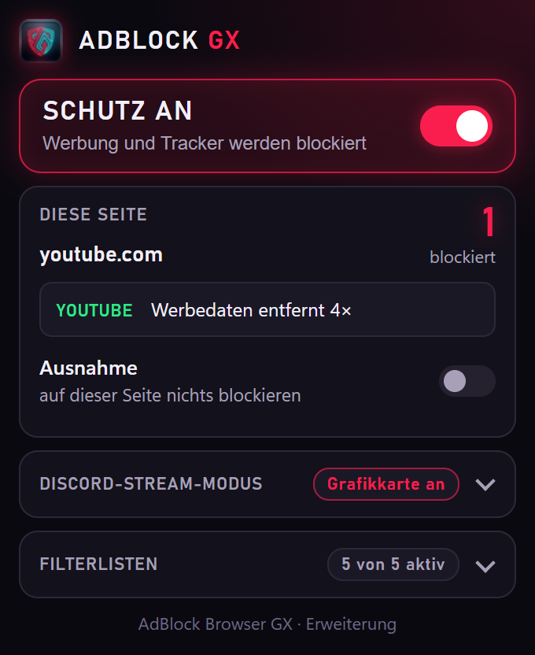
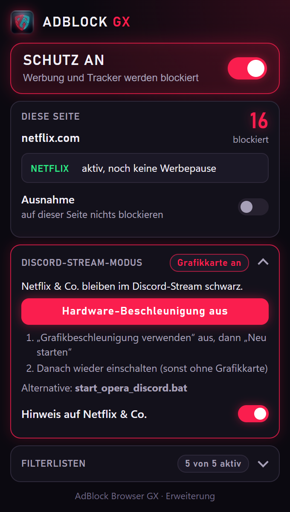
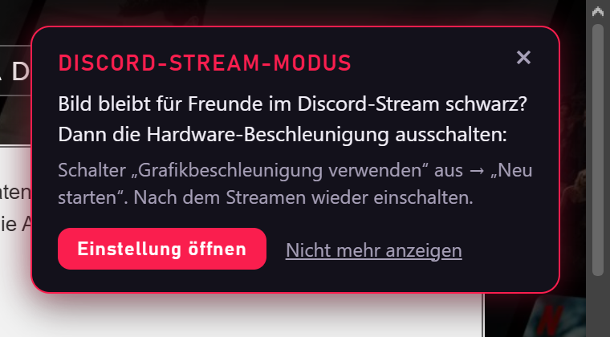

# 🛡️ AdBlock GX – Browser-Erweiterung (Chrome / Opera GX)

Werbeblocker als Erweiterung (Manifest V3) für **Chrome** und **Opera GX**, mit den Funktionen des
Desktop-Browsers [AdBlock Browser GX](https://github.com/abilas-sivarajah/adblock-browser-gx) – inklusive
**Discord-Stream-Modus**, damit Netflix im Discord-Bildschirm-Teilen nicht schwarz bleibt – und auf dem
Stand der Apps **GX Tube** ([Android](https://github.com/abilas-sivarajah/adblock-tube-gx),
[Desktop](https://github.com/abilas-sivarajah/adblock-tube-gx-desktop)): derselbe Twitch-Werbeblocker,
SponsorBlock, Shorts ausblenden, Originalton und Dislikes auf YouTube.

Die Seiten-Scripts für YouTube und Netflix werden **nicht kopiert**: Der Build erzeugt sie aus
`scripts/*.js` des Desktop-Browsers – eine Änderung dort landet beim nächsten Build automatisch in der
Erweiterung. Der **Twitch-Werbeblocker** liegt seit 11/2026 in `scripts/` dieses Repos: Er ist der aus
GX Tube Desktop (`third_party/adblock-gx`), der dort weiterentwickelt wurde und neuer ist als der des
Desktop-Browsers.

---

## 🌟 Funktionen

- **Netzwerk-Blocker** (declarativeNetRequest): EasyList, EasyList Germany, Peter Lowe's Liste und
  EasyPrivacy plus die **Seiten-Fixes** des Desktop-Browsers (`site_fixes.txt`). Aus rund 117.000
  Netzwerk-Filtern werden ~14.700 Chrome-Regeln: reine Domain-Regeln (`||werbung.example^`) mit gleichen
  Optionen stehen gesammelt in **einer** Regel (Peter Lowe = 1 Regel). Damit passen alle Listen in die
  30.000 Regeln, die Chrome jeder Erweiterung garantiert. Die **Zahl am Symbol** zeigt die blockierten
  Anfragen des Tabs.
- **Werbeflächen ausblenden** (kosmetische Filter) wie im Desktop-Browser: Jeder Frame meldet seine
  CSS-Klassen/IDs, die Erweiterung antwortet mit den passenden Regeln der Listen (seitenspezifisch,
  generisch, Stil-Regeln). Eingefügt als Benutzer-Stylesheet – wirkt auch auf Seiten mit strenger
  Content-Security-Policy.
- **YouTube** ohne Werbung: Werbedaten werden aus den Player-Antworten entfernt, Reste übersprungen,
  Werbeblöcke und der Adblock-Hinweis ausgeblendet. Dazu wie in GX Tube (Popup → YouTube):
  - **SponsorBlock:** Gesponserte Abschnitte *im* Video („Dieses Video wird präsentiert von …“) werden
    übersprungen – mit **„Rückgängig“** im Hinweis; direkt aufeinanderfolgende Abschnitte in einem
    Sprung. Auf der Zeitleiste grün markiert, als „stumm“ markierte Abschnitte werden stumm geschaltet
    (gelb), das **Highlight** steht als ◆ auf der Zeitleiste und als Knopf „◆ Highlight“ im Player, dazu
    der Hinweis „Gesponsertes Video“, wenn das ganze Video Werbung ist. Kategorien wählbar (Standard:
    Sponsor, Eigenwerbung, Erinnerung zum Abonnieren). Abfrage über den Hash-Präfix – die Video-ID
    bleibt privat.
  - **Shorts ausblenden** (standardmäßig aus): Startseite, Abos, Suche, Kanäle, ähnliche Videos,
    Seitenleiste; Shorts-Links öffnen als normales Video.
  - **Immer Originalton** (an): keine automatische Synchronfassung oder KI-Übersetzung – der Player
    wird auf die Originalspur umgeschaltet (einmal pro Video, eine Handwahl danach bleibt).
  - **Dislikes anzeigen** (aus): Zahl von Return YouTube Dislike neben dem Daumen nach unten (dafür geht
    die Video-ID an returnyoutubedislikeapi.com).
- **Twitch** ohne Video-Werbung – derselbe Blocker wie in GX Tube Android/Desktop (Techniken nach
  [TTV-AB](https://github.com/GosuDRM/TTV-AB) von GosuDRM):
  1. Zuerst wird die Werbung per **Ad-Spoofing** als gesehen gemeldet (Impression, Quartile und
     Pod-Abschluss via GraphQL) – oft endet die Pause dann sofort, der eigene Stream läuft ohne Wechsel
     weiter. Klappt das nicht, wird es für dieselbe Werbung eine Minute nicht erneut versucht.
  2. Sonst springt eine werbefreie Ersatz-Sitzung ein: sofort in 360p – **zwei getrennte Sitzungen**
     (als Android- und iOS-App) gleichzeitig gefragt, hat eine Werbung, läuft die andere –, nach einer
     zweiten Prüfung in voller Qualität. Liegt eine werbefreie Sitzung ein paar Sekunden zurück, wird
     sie **sofort** genommen statt bis zu 6 s schwarzem Bild. Danach geht es ohne Hänger zurück zum
     eigenen Stream.
  3. Nur wenn Twitch überall Werbung zeigt (Werbepause des Streamers), kommt schwarzes, stummes Bild
     statt Werbung, mit Restzeit.

  VOD-Werbung, Werbe-Anfragen und Werbebanner werden blockiert. Ad-Spoofing ist **standardmäßig an**
  wie in den Apps, abschaltbar im Popup → Twitch („Werbung als gesehen melden“, wirkt sofort ohne
  Neuladen). Es geschieht mit deinem Twitch-Konto für Werbung, die nie lief – kann gegen die
  Nutzungsbedingungen von Twitch verstoßen.
- **Netflix** (Abo mit Werbung): Werbepausen und Pausen-Werbung werden aus den Daten entfernt, ein
  durchgerutschter Spot wird abgedeckt.
- **South Park** (southpark.de) startet ohne Werbung (Seiten-Fixes).
- **Popup im GX-Look:** Schutz an/aus, Ausnahme für die aktuelle Seite, blockierte Anfragen, Status der
  YouTube/Twitch/Netflix-Scripts („Werbedaten entfernt 6ד, „Sponsor übersprungen 2×, 1:13 gespart“,
  „Highlight bei 4:20“), Filterlisten an/aus, Discord-Stream-Modus, YouTube (SponsorBlock mit
  Kategorien, Shorts, Originalton, Dislikes), Twitch-Ad-Spoofing, Updates.
- **Automatische Updates** aus GitHub beim Browserstart und stündlich – die Erweiterung lädt sich
  danach selbst neu.

| Popup auf YouTube | Popup auf Netflix | Hinweis auf Netflix |
|---|---|---|
|  |  |  |

## 🚀 Bauen und laden

Voraussetzungen: **Python 3** (nur Standardbibliothek; **Pillow** optional für die Icons, **Node.js**
optional für die Syntax-Prüfung der Seiten-Scripts) und der Desktop-Browser im Ordner
**`AdBlockBrowser` neben diesem Repo**:

```powershell
git clone https://github.com/abilas-sivarajah/adblock-browser-gx AdBlockBrowser
git clone https://github.com/abilas-sivarajah/adblock-gx-extension AdBlockGX-Extension
cd AdBlockGX-Extension
python tools/build_extension.py
```

| Option | Wirkung |
|---|---|
| `--update` | Filterlisten neu laden (sonst Cache bis 12 h alt, `tools\.cache\filters\`) |
| `--offline` | nichts herunterladen (Cache, sonst die Listen des Desktop-Browsers) |
| `--browser PFAD` | Desktop-Browser liegt woanders (auch per Umgebungsvariable `ADBLOCK_BROWSER_DIR`) |

Der Build erzeugt `extension\generated\` (nicht in Git), meldet Regeln pro Liste, übersprungene Regeln
nach Grund und die Chrome-Limits. Ist Node.js installiert, prüft er die Seiten-Scripts und die eigenen
Scripts der Erweiterung auf Syntaxfehler – ein kaputtes Script würde im Browser sonst einfach nicht
laufen. Fehlt eine Filterliste
(kein Download, kein Cache), steht am Ende eine WARNUNG.

**Laden:** `chrome://extensions` bzw. `opera://extensions` → **Entwicklermodus** an → **Entpackte
Erweiterung laden** → Ordner `extension\`. Danach das Symbol über das Puzzle-Menü anheften.

- **Automatische Updates** einmal einrichten (siehe unten): `python tools/update_extension.py --install`
- Nach einem Build lädt sich die Erweiterung selbst neu (sobald ihr Service Worker das nächste Mal
  aufwacht). Nur beim ersten Mal nach diesem Update von Hand auf **Neu laden** klicken.
- **Opera GX:** den eingebauten Werbeblocker von Opera ausschalten (Einstellungen → „Werbung
  blockieren“). Er kennt die Seiten-Fixes nicht – South Park meldet dann z. B. „Ad Blocker benutzt“.

## 🔄 Automatische Updates

Was sich auf GitHub ändert (in diesem Repo oder im Desktop-Browser), kommt **spätestens beim nächsten
Browserstart** an – und stündlich, solange der Browser läuft:

1. Beim Start (und dann jede Stunde) startet die Erweiterung über **Native Messaging**
   `tools/update_extension.py`.
2. Das Skript holt beide Repos per `git fetch` und spult vor (nur **Fast-Forward**: eigene Commits
   und ungespeicherte Änderungen werden nie angefasst – dann steht im Popup ein Hinweis).
3. Es baut neu, wenn sich der Code geändert hat oder die Filterlisten älter als 12 h sind. Der Build
   schreibt jede Datei über eine Zwischendatei und zuletzt `generated/build_info.json`.
4. Die Erweiterung sieht den neuen Build und **lädt sich selbst neu**. Schlägt der Build fehl, bleibt
   die laufende Version aktiv.

Einmal einrichten (pro Windows-Benutzer, ohne Admin-Rechte; trägt den Updater für Chrome und Opera
in der Registry ein):

```powershell
python tools/update_extension.py --install
```

| Befehl | Wirkung |
|---|---|
| `python tools/update_extension.py` | jetzt aktualisieren (Ausgabe in der Konsole) |
| `--force` | auch ohne Änderungen neu bauen |
| `--uninstall` | Registrierung entfernen |

Im Popup unter **Updates**: Stand, letzte Prüfung, Hinweise, **Jetzt aktualisieren** und der Schalter
**Automatisch**. Protokoll: `tools\.cache\update.log`. Nach dem Verschieben des Ordners oder einem
neuen Python `--install` erneut ausführen (der Updater gilt nur für die Erweiterung aus diesem Ordner).

## 🎮 Discord-Stream-Modus

Mit Hardware-Beschleunigung nutzt der Browser für Netflix den hardwaregeschützten Kopierschutz
(gemessen in Opera GX: PlayReady SL3000 nur mit Grafikkarte verfügbar). Das Video läuft dann über ein
geschütztes Overlay – Discord sieht nur **Schwarz**. Eine Erweiterung kann die Beschleunigung nicht
selbst abschalten und den Browser nicht mit Parametern neu starten, deshalb:

1. **Hinweis + Knopf** (getestet in Opera GX: Bild im Stream sichtbar): Die Erweiterung erkennt, ob die
   Grafikkarte genutzt wird. Popup → **„Hardware-Beschleunigung aus“** öffnet `chrome://settings/system`
   bzw. `opera://settings/system` → Schalter **„Grafikbeschleunigung verwenden“** aus → **„Neu
   starten“**. Das Popup zeigt dann „Stream-Modus an“. Nach dem Streamen wieder einschalten – sonst
   laufen Videos ohne Grafikkarte, Netflix evtl. in geringerer Auflösung.
   Auf Netflix, Prime Video und Disney+ erscheint dazu einmal pro Sitzung ein kleines Banner
   (im Popup abschaltbar).
2. **`start_opera_discord.bat`** (ohne Umschalten): startet Opera GX (sonst Chrome) mit denselben
   Parametern wie der Desktop-Browser (`--disable-gpu --disable-gpu-compositing
   --disable-accelerated-video-decode --disable-direct-composition-video-overlays`) in einem **eigenen
   Profil** (`%LOCALAPPDATA%\AdBlockGX\Discord-…`) – sonst würde ein schon laufender Browser die
   Parameter ignorieren. Ohne Adresse öffnet sich Netflix.
   - Im neuen Profil einmal bei Netflix anmelden. Den Kopierschutz (Widevine) lädt der Browser im neuen
     Profil erst nach ein paar Minuten nach – startet Netflix nicht sofort, kurz warten.
   - Opera lädt die Erweiterung über `--load-extension` selbst. **Chrome** erlaubt das nicht mehr: dort
     die Erweiterung im Discord-Profil einmal per Hand laden (siehe oben).
   - Desktop-Verknüpfung „Opera GX (Discord)“: `python tools/create_discord_shortcut.py` (braucht pywin32).

## ⚠️ Was nicht geht

- **Nur im Desktop-Browser:** eigener Fensterrahmen, Tabs, Startseite, Werbe-Protokoll, Popup-Blocker
  (Chrome/Opera blocken Popups selbst), Umschalten der Grafikkarte mit einem Klick.
- **Nur in GX Tube:** DeArrow (Titel/Vorschaubilder ohne Clickbait), Kapitel aus SponsorBlock,
  Hintergrundwiedergabe, Streamen auf den PC, Twitch-Favoriten und -Suche – das sind Funktionen der
  App-Oberfläche, nicht der YouTube-/Twitch-Seite.
- **YouTube-Extras hängen an YouTubes Seitenaufbau:** Ändert YouTube die Shorts-Elemente, den
  Dislike-Knopf oder die Player-Schnittstelle für Tonspuren, greift die jeweilige Funktion nicht mehr
  (die Seite läuft trotzdem normal). Getestet ist gegen nachgebaute Seiten (`dev_tests/ext_chromium.mjs`).
- **Nicht umwandelbare Filter** werden beim Build übersprungen und gezählt: `$popup`, Seitensperren
  (`$document`, blockiert der Desktop-Browser auch nicht), `$redirect`, `$removeparam`, `$csp`,
  `$rewrite`, Scriptlets (`##+js(...)`), erweiterte Kosmetik (`#?#`, `#$#`, `:has-text`), und
  Regex-Regeln, die größer sind als Chrome erlaubt (ca. 100 RE2-Instruktionen, gemessen).
- **Seiten mit Ad-Shield** (z. B. wetter.com, welt.de): Wird deren Werbung geblockt, lädt Ad-Shield sie
  über wechselnde Domains nach; blockiert oder versteckt man auch das, löscht die Seite ihren Inhalt und
  zeigt eine Sperre („Ich verwende keinen Adblocker“). Dort bleibt Werbung sichtbar.
- **Twitch:** Während der Werbepause eines Streamers gibt es keinen werbefreien Stream – die Wartezeit
  bleibt (schwarzes Bild mit Hinweis).
- `$important` liegt über normalen Block-Regeln, aber unter Ausnahmen (in der Brave-Engine des
  Desktop-Browsers gewinnt `$important` auch gegen Ausnahmen; betrifft nur ein Dutzend Regeln).

## 🔧 Technik

| | |
|---|---|
| Prioritäten | Ausnahmeliste (dynamisch, 100) > Seiten-Fix-Ausnahmen (4) > Ausnahmen der Listen (3) > `$important` (2) > Block (1) |
| Twitch | `scripts/twitch_main.js` (Seite) + `twitch_worker.js` (läuft im Player-Worker, schreibt die HLS-Playlisten um) + `twitch_hold.ts` (schwarzes Ersatz-Stück). Der Worker ist unverändert der von GX Tube Desktop; `twitch_main.js` reicht den Ad-Spoofing-Schalter aus `content/twitch_bridge.js` live an den Worker weiter. Player-Typen: `TWITCH_BACKUP_TYPES` in `tools/build_extension.py` |
| YouTube-Extras | `content/youtube_extras.js` (isolierte Welt: SponsorBlock, Shorts, Dislikes, Hinweise) fragt den Service Worker nach Einstellungen und Daten (`sponsorblock.js` – die Anfragen kommen aus dem Service Worker, YouTubes CSP spielt keine Rolle); `content/youtube_extras.css` (Shorts, über `html[data-abgx-no-shorts]` geschaltet); `content/youtube_audio.js` (Seitenwelt: Tonspur über die Player-Schnittstelle, `html[data-abgx-original-audio]`) |
| Einstellungen | `settingsVersion` 2: bestehende Einstellungen bekommen einmal Ad-Spoofing an (vorher stand immer der alte Standard „aus“ gespeichert), alles andere bleibt |
| `$domain=` | Listen: `initiatorDomains` (Frame, der anfragt – wie in uBlock/ABP). Seiten-Fixes: `topDomains` (Seite in der Adressleiste – wie der Desktop-Browser prüft). Daher `minimum_chrome_version` 145. |
| Ausnahmeliste | eine dynamische `allowAllRequests`-Regel für `main_frame`/`sub_frame`; die Seiten-Scripts bekommen sie als `excludeMatches` |
| Schutz aus | Regelsätze aus, Scripts abgemeldet, keine Kosmetik |
| Regelsätze | `site_fixes` immer an; die Listen an, soweit `getAvailableStaticRuleCount()` Platz lässt |

## 🧪 Tests

| Befehl | Prüft |
|---|---|
| `python dev_tests\dnr_unit.py` | Regel-Konverter: Filterzeilen rein → erwartete Chrome-Regeln raus (48 Tests) |
| `node --test dev_tests\twitch_worker.test.mjs` | Twitch-Werbeblocker gegen ein nachgebautes Twitch (ohne Netz): zweite 360p-Brücke, sofort statt schwarz, Ad-Spoofing zuerst, Rest-Werbung herausschneiden, Prefetch, Fehlschlag, Schalter (gleiche Fälle wie in GX Tube Desktop/Android) |
| `node --test dev_tests\youtube_extras.test.mjs` | SponsorBlock-Antworten, Hash-Präfix, Fehlerfälle, Return YouTube Dislike; welche Tonspur der Originalton ist |
| `node dev_tests\ext_chromium.mjs` | Erweiterung in Chromium (Playwright) gegen nachgebaute YouTube-/Twitch-Seiten: SponsorBlock (Sprung, Rückgängig, stumm, Zeitleiste, Highlight, ganzes Video), Originalton, Shorts, Dislikes, Popup, Ad-Spoofing-Schalter ohne Neuladen bis in den Worker, Einstellungs-Umstellung |
| `python dev_tests\ext_smoke.py` | Erweiterung in unsichtbarem Opera GX (eigenes Testprofil): Scripts, Regelsätze, Regex-Regeln, YouTube/Twitch/Netflix, Twitch-Ad-Spoofing-Schalter, Blockieren, Ausblenden trotz CSP, South Park, Ausnahme, Schutz aus, Neustart, `chrome://extensions` ohne Warnungen |
| `python dev_tests\ext_discord.py` | Discord-Stream-Modus in einem Opera-Fenster außerhalb des Bildschirms: Banner, Popup, Einstellungs-Knopf, Parameter der `.bat` |
| `python dev_tests\ext_update.py` | Automatische Updates: Erweiterungs-ID, Alarm, Updater antwortet (nach `--install`), Popup, Selbst-Neuladen bei neuem Build (genau einmal); `--live` auch ein echtes Update |

Die Python-Browser-Tests brauchen `pip install websockets` und Opera GX (`--browser` für einen anderen
Chromium-Browser; Chrome-Stable lädt keine Erweiterungen per Parameter). `ext_chromium.mjs` braucht
Playwright mit dessen Chromium (`npm i -g playwright`, `npx playwright install chromium`). Die Node-Tests
der YouTube-/Netflix-Scripts (`nf_unit.js`) liegen im Repo des Desktop-Browsers.

## 📁 Projektstruktur

```
AdBlockGX-Extension/
├── extension/
│   ├── manifest.json          # Manifest V3 (Regelsätze trägt der Build ein)
│   ├── background.js          # Service Worker: Scripts registrieren, Regelsätze, Ausnahmeliste, Kosmetik, Discord, YouTube-Extras
│   ├── sponsorblock.js        # SponsorBlock + Return YouTube Dislike (Anfragen aus dem Service Worker)
│   ├── popup.html/.js/.css    # Popup im GX-Look
│   ├── gpu.js                 # erkennt, ob die Hardware-Beschleunigung an ist
│   ├── content/cosmetic.js    # Klassen/IDs melden (alle Frames)
│   ├── content/discord_hint.js# Hinweis-Banner auf Netflix, Prime Video, Disney+
│   ├── content/twitch_bridge.js   # Ad-Spoofing-Schalter live in die Twitch-Seite
│   ├── content/youtube_extras.js/.css # SponsorBlock, Shorts ausblenden, Dislikes
│   ├── content/youtube_audio.js   # Originalton (Seitenwelt)
│   ├── icons/                 # aus assets/icon.png des Desktop-Browsers
│   └── generated/             # vom Build (nicht in Git)
├── scripts/                   # Twitch-Werbeblocker (wie GX Tube Desktop third_party/adblock-gx)
│   ├── twitch_main.js         # Seite: Worker einhängen, Hinweise, Statistik, Schalter weiterreichen
│   ├── twitch_worker.js       # im Player-Worker: Ad-Spoofing, Ersatz-Sitzungen, schwarzes Bild
│   └── twitch_hold.ts         # 1 s Schwarz + Stille (MPEG-TS)
├── tools/
│   ├── build_extension.py     # Build
│   ├── update_extension.py    # Update aus GitHub (Native Messaging), --install
│   ├── abp2dnr.py             # Adblock-Syntax → declarativeNetRequest + Kosmetik-Daten
│   └── create_discord_shortcut.py
├── dev_tests/                 # dnr_unit.py, ext_smoke.py, ext_discord.py, ext_update.py,
│                              # twitch_worker.test.mjs, youtube_extras.test.mjs, ext_chromium.mjs
├── docs/                      # Screenshots für diese README
└── start_opera_discord.bat    # Opera GX im Discord-Stream-Modus
```
